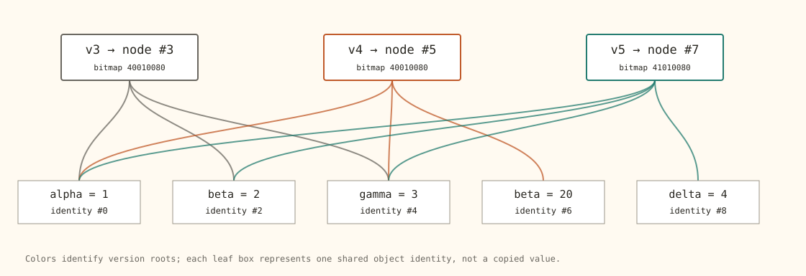

# Persistent HAMT map

**[View the report in your browser](https://Michaelhoang8.github.io/persistent-hamt-map/)**

An immutable **hash-array-mapped trie** implemented in Java 21 for String keys and bounded integer values. Bitmap-indexed branches route 32-bit hashes, explicit full-hash collision nodes retain distinct keys, and insert/update/delete copy only the affected path. Historical roots remain readable and can be used as parents of new versions.

**[Technical report](docs/report.html)** · [Screenshots](docs/screenshots/README.md) · [Review recording](docs/recordings/README.md) · [Implementation contract](docs/implementation.md)



## Recorded results

The original trace records **23 operations and 24 versions**, including forks, equal-value replacements, absent deletes, true `Aa`/`BB` hash collisions, negative hash codes and 30-bit shared prefixes. After every operation, every retained version is checked against its own independently copied HashMap oracle: **299 complete historical comparisons** for this trace.

| Change | Reachable nodes afterward | Shared with parent | New reachable nodes |
| --- | ---: | ---: | ---: |
| v3 → v4: beta 2 → 20 | 4 | 2 | 2 |
| v3 → v5: add delta | 5 | 3 | 2 |
| v3 → v7: remove absent key | 4 | 4 | 0 |
| v3 → v8: put beta=2 again | 4 | 4 | 0 |

The sharing counts compare **object identity**, not equal contents or estimated heap size. v7/v8 retain the exact original map instance and root. The inspection graph assigns one label to each actual reachable node object across all supplied versions.

Three additional retained-update workloads keep 201 versions each:

| Workload | Distinct reachable node objects across versions | Sum of each version's reachable-node count |
| --- | ---: | ---: |
| 128 ordinary starting keys | 694 | 28,764 |
| 1,024 ordinary starting keys | 2,012 | 258,290 |
| 64 same-hash starting keys | 371 | 1,317 |

These are logical graph counts. They **do not measure JVM bytes, allocation rate, retained heap, GC savings or cache behavior**. Branch child arrays, collision entry arrays, Entry records, Strings, map wrappers and version-list objects are outside the node count.

## Run it

Requires a **JDK 21**. There are no external Java dependencies. The standard-JDK launcher compiles source and tests with `--release 21 -Xlint:all -Werror` before execution.

```sh
java tools/Run.java test
java tools/Run.java replay data/version-trace.csv
java tools/Run.java measure results-local
```

Commands work in PowerShell and POSIX shells from the repository root. Ubuntu and Windows CI test the committed evidence, then generate fresh measurements under ignored `results-ci/`. No timing thresholds are enforced.

To deliberately regenerate synthetic inputs and replace recorded evidence:

```sh
java tools/Run.java generate
java tools/Run.java measure
python presentation/render.py
```

Python 3.11+ is needed only for the report renderer, which uses its standard library. Rendering reads preserved measurements and never reruns the Java workloads. Report/SVG hashes are separate from core measurement provenance. Optional browser capture and media tests are not part of the core source manifest.

## Public map contract

```java
Hamt original = Hamt.empty().put("alpha", 1).put("beta", 2);
Hamt changed = original.put("beta", 20);
Hamt sibling = original.put("gamma", 3);

original.get("beta"); // 2
changed.get("beta");  // 20
sibling.get("beta");  // 2
original.sharingWith(changed); // Exact reachable-node identity intersection
```

- Keys are non-null Strings, at most 128 UTF-16 code units and well-formed UTF-16. Empty Strings, embedded NUL/control characters and Unicode are allowed. Equality is exact `String.equals`; no normalization or case folding occurs.
- Values are primitive integers in `[-1_000_000,1_000_000]`. There is no stored null. `get` returns null only for an absent key.
- Each map supports at most 16,384 entries. Inserting an absent key at capacity fails; replacing an existing key is allowed. Removing a key can free capacity in the new version without changing the old one.
- `put` with an unchanged value and `remove` for an absent key return the same Hamt instance. A changed operation returns a new wrapper/root, with unaffected subtrees shared.
- `entries`, stats and inspection results expose copied immutable records/lists, never internal mutable arrays. Entries are sorted by Java String ordering for deterministic output.
- The map supplies no mutable/transient builder, custom hash/equality strategy, iteration cursor, concurrent-update coordinator or general `java.util.Map` implementation.

The core map contains leaf/collision/branch nodes and arrays. It does **not** wrap a HashMap. HashMap appears in independent replay/tests and the explicit full-map-copy benchmark baseline. IdentityHashMap is used only for diagnostic identity sets/labels.

## Hash routing and deletion

The trie uses the unchanged `String.hashCode()` value and consumes its low five bits first, then successive five-bit chunks. Unsigned right shift handles negative hashes. At the seventh level only the two remaining hash bits can be nonzero.

```text
slot  = (hash >>> shift) & 31
bit   = 1 << slot
index = bitCount(bitmap & (bit - 1))
```

A branch's packed child array contains only occupied slots. The sign bit for slot 31 is a valid bitmap bit; bit arithmetic and bitCount determine its index correctly. Two distinct complete hashes eventually diverge within seven chunks.

Distinct keys with exactly equal hashes share a **collision node**. For example, `"Aa"` and `"BB"` both hash to `0x00000840`. Collision lookups scan full keys; update/remove copy the bucket. The 64-key `Aa`/`BB` family deliberately exercises this linear worst case. A 32-bit hash collision never causes one key to overwrite another.

When deletion leaves a sole terminal (leaf or collision), it can be promoted because it carries a complete hash. A sole branch cannot be promoted: its depth determines which hash chunk it consumes. Unary branch chains therefore remain when deeper keys still share a prefix. Tests exercise hashes `0x00000001`, `0x40000001`, and `0x80000001`, which share 30 low bits, and contraction all the way back to one leaf and an empty root.

## Version trace and CLI

`replay` reads an exact four-column CSV:

```csv
parent,operation,key_base64,value
0,put,YWxwaGE=,1
1,put,YmV0YQ==,2
2,remove,YWxwaGE=,
```

Version 0 is empty. Row k creates version k from the specified earlier parent. Operations are `put` with a bounded canonical decimal value or `remove` with an empty value. Keys are canonical padded Base64 of well-formed UTF-8; an empty key has an empty field. This preserves control-character deep-prefix fixtures without ambiguous CSV escaping.

At most 128 operations and 262,144 input bytes are accepted. Invalid parents, Base64, UTF-8, key/value bounds and malformed rows fail explicitly. `java tools/Run.java --help` lists commands. Exit 0 means completion; invalid input or execution errors exit 2 with a concise message. A failed insertion never mutates its parent map.

`Hamt.inspect` accepts 1–256 versions. Its labels are assigned by first traversal of actual identities and remain consistent within that one inspection. They are not JVM addresses and are not globally comparable across unrelated inspections. “Retired nodes” means nodes present in the parent but absent from the child; retained parent versions can still reach them.

## Workloads and timing scope

[data/benchmark-operations.csv](data/benchmark-operations.csv) preserves every starting entry, update and read. Definitions are deterministic in `Evidence.workloads()` with seed 731029. Before measuring, the driver requires the saved CSV to match those definitions exactly; a modified fixture is rejected rather than silently ignored. `generate` intentionally resets it.

Each workload has 200 insert/update/delete operations and retains the initial map plus every subsequent version. The baseline creates `new HashMap<>(previous)` for **every** operation, applies that operation, and retains an unmodifiable view of the copy. It also copies on absent deletes; HAMT may return its unchanged instance. This compares that specified full-copy persistence strategy, not an optimized no-op-aware baseline or another persistent-map library.

Reads are a separate batch of 4,096 queries against the initial maps, with 7/8 hits and 1/8 deliberate misses. They are not mixed with updates or measured against the final version. Repeated String objects mean warmed/cached String hash computation is part of the workload conditions.

Each phase has two warm-ups and seven measured repetitions per implementation. Implementation order alternates each repetition. `System.nanoTime` encloses the update loop/version-list retention or the read loop; setup, complete oracle comparisons, identity inspection, serialization and file I/O are excluded. A volatile reference retains the full result list after the timed update, and checksums are consumed. All version snapshots are independently checked outside timing.

The 84 raw samples retain nanoseconds and checksums. Tests verify counts, operations and checksum equality, without requiring one implementation to be faster. JVM compilation, GC, CPU scheduling and measurement order remain uncontrolled. This is a bounded local study, not JMH, a throughput guarantee, a claim of constant-time collision handling or a general production speedup.

## Tests and evidence

Twelve seeded histories retain every version while forking from random prior parents. After each of 120 operations per seed, all historical versions are checked against independently copied oracle maps: **88,560 full map/snapshot/lookup comparisons**. Inputs include a 16-key collision family, ordinary keys, deep shared-prefix keys, a negative hash, empty String and Unicode.

Additional checks cover all 32 bitmap slots; capacity at 16,384 entries; replacement while full; old-version preservation after failed insertion; collision expansion/update/contraction; absent deletes; equal-value puts; immutable diagnostic lists; null/key/value validation; and twelve CLI/error cases.

An independent review group inserts 129 distinct empty/NUL-only keys whose complete String hashes are all zero, retaining 130 versions. It checks replacement persistence, collision-to-leaf-to-collision transitions and deletion back to an empty map. All five Java test groups pass under strict compilation.

Preserved-evidence checks replay every original operation and snapshot, independently traverse bitmap slots to validate each terminal's hash prefix, verify actual reachable-node intersections between versions, reconcile all workload snapshots/counts, and verify every timing checksum. Source/input/test and output hashes use UTF-8 with CRLF normalized to LF. The report and SVGs have their own normalized provenance manifest.

| Artifact | Contents |
| --- | --- |
| [data/version-trace.csv](data/version-trace.csv) | Original branching version operations, including binary-safe keys. |
| [results/version-replay.json](results/version-replay.json) | Every immutable snapshot, parent relationship and complete shared identity graph. |
| [results/version-sharing.csv](results/version-sharing.csv) | Exact per-change node/shared/new/retired counts. |
| [results/workloads/](results/workloads/) | Per-update identity counts and final snapshots for each retained workload. |
| [results/timings.csv](results/timings.csv) | 84 measured update/read timing rows and observed checksums. |
| [results/summary.json](results/summary.json) | Workload dimensions and retained graph counts. |
| [results/environment.json](results/environment.json) | JVM/platform metadata and explicit hashed core files. |

## Reference and provenance

Phil Bagwell, [Ideal Hash Trees](https://lampwww.epfl.ch/papers/idealhashtrees.pdf), EPFL technical report, 2001, supplies the bitmap-indexed hash-trie background. This project adds its own bounded immutable/path-copy implementation and synthetic experiments; it does not reproduce the paper's original system or benchmarks.

This is **AI-assisted portfolio work**. Operations and data are synthetic and owned by the project. Timings, node identities and replay checks come from actual local JVM execution. Screenshots/recordings document inspection of the report, not historical manual implementation work. No production deployment, physical memory savings, cryptographic hash robustness or general performance advantage is claimed. Environment metadata excludes usernames, hostnames and personal paths.
